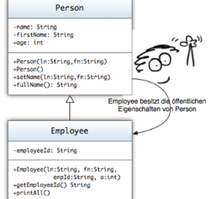

# Vererbung in Java

> Aufgabe1

---

## Projektinformationen

| Feld            | Inhalt                 |
|-----------------|------------------------|
| **Projektname** | Vererbung in Java       |
| **Klasse**      | [2aAPC]               |
| **Schuljahr**   | 2026/27                |
| **Abgabedatum** | [20.11.2026]            |
| **Autor/in**    | Samuel Schlintl        |
| **Lehrer/in**   | [Gerhard Jarz]      |
| **Fach**        | [ITL1]                 |

---

## Projektbeschreibung

### Ziel der Applikation

Ziel ist, dass die Klasse Employees von der Klasse Person erbt, in Java.

### Hauptfunktionen

- Person und Employees erstellen
- Namen und Alter speichern
- Vollständigen Namen ausgeben
- MitarbeiterID verwalten
- VorgesetztenID verwalten
- Gehalt setzen und abrufen
- Gehalt prozentual erhöhen
- Mitarbeiterinformationen in der Konsole ausgeben

### Lernziele

- Vererbung implementieren
- Klassen und Objekte verwenden
- Konstruktoren und Methoden implementieren

### Klassendiagramm

#### Person

**Attribute:**

| Name        | Datentyp |
|-------------|----------|
| `name`      | `String` |
| `firstName` | `String` |
| `age`       | `int`    |

**Konstruktoren und Methoden:**

| Methode                          | Rückgabetyp |
|----------------------------------|-------------|
| `Person(ln: String, fn: String)`  | –           |
| `Person()`                       | –           |
| `setName(ln: String, fn: String)` | `void`      |
| `fullName()`                     | `String`    |

#### Employee (erbt von Person)

**Attribute:**

| Name           | Datentyp |
|----------------|----------|
| `employeeId`   | `String` |
| `supervisorId` | `String` |
| `salary`       | `float`  |

**Konstruktoren und Methoden:**

| Methode                                                 | Rückgabetyp |
|---------------------------------------------------------|-------------|
| `Employee(ln: String, fn: String, empId: String, a: int)` | –           |
| `getEmployeeId()`                                       | `String`    |
| `printAll()`                                            | `void`      |
| `setSupervisorId(String)`                               | `void`      |
| `getSupervisorId()`                                     | `String`    |
| `setSalary(float)`                                      | `void`      |
| `getSalary()`                                           | `float`     |
| `salaryIncrease(float)`                                 | `void`      |

---

## Screenshot

## 📸 Screenshot



---

## Entwicklungsumgebung

### Verwendete Software & Tools

| Tool / Software         | Version   | Zweck                          |
|-------------------------|-----------|--------------------------------|
| Visual Studio Code      | [Version] | Code-Editor                    |
| Java JDK                | [Version] | Kompilieren und Ausführen      |
| Extension Pack for Java | [Version] | Java-Entwicklung in VS Code    |
| Git                     | [Version] | Versionskontrolle              |
| GitHub                  | –         | Repository-Verwaltung          |

### Frameworks & Bibliotheken

- /

### Betriebssystem (Entwicklung)

- **OS:** Windows 11

---

## Installation & Ausführung

### Voraussetzungen

- [ ] Java JDK installiert
- [ ] Visual Studio Code installiert
- [ ] Extension Pack for Java installiert
- [ ] Git installiert

### Schritte

```bash
# 1. Repository klonen
git clone git clone https://github.com/itsScoobert/1.-Aufgabe_ITL1.git

# 2. In den Projektordner wechseln
cd 1.-Aufgabe_ITL1

# 3. JavaDateien kompilieren
javac Main.java Person.java Employee.java

# 4. Programm starten
java Main
```

---

## Quellen

### Links & Dokumentation

| Quelle            | URL / Beschreibung                                |
|-------------------|---------------------------------------------------|
| Java Documentation| https://docs.oracle.com/en/java/                  |
| VS Code Java      | https://code.visualstudio.com/docs/languages/java |
| Aufgabenstellung  | Klassendiagramm aus dem Schulunterricht           |

### KI-Unterstützung

| Tool    | Verwendeter Prompt / Zweck                                                                 |
|---------|--------------------------------------------------------------------------------------------|
| ChatGPT | Erklärung von Vererbung, Konstruktoren und Methoden |

---

## Bekannte Probleme / Limitierungen

- /

---

## 📄 Lizenz

Dieses Projekt wurde im Rahmen des Schulunterrichts erstellt und
ist nicht für die kommerzielle Nutzung vorgesehen.

Zuletzt geändert: Freitag, 20. November 2026